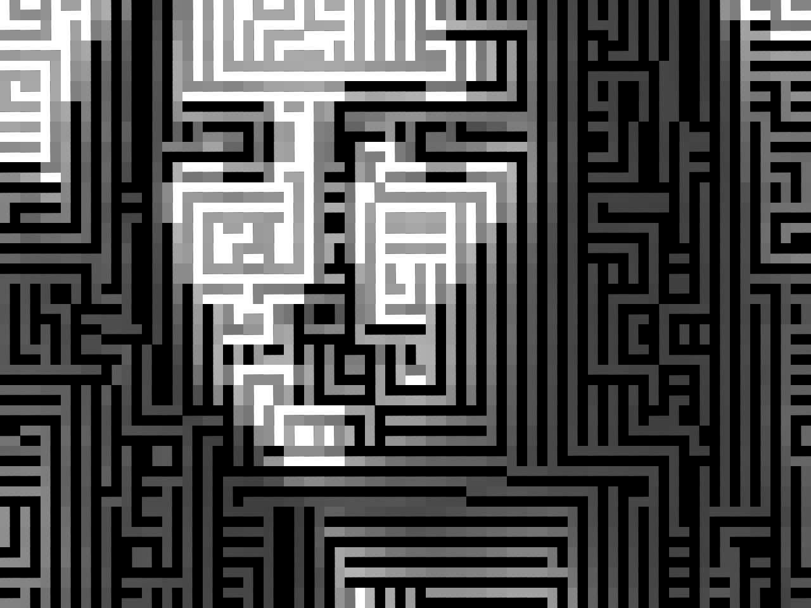

# Mona Lisa Block Mosaic

Renders the Mona Lisa as a mosaic of 32×32 directional tiles, in MATLAB.
Each source pixel becomes one tile, chosen by the local edge direction and
brightness-adjusted to match the pixel, so the tiles trace the edges of the image.



| Input (40×30) | Output (1280×960) |
|---|---|
| `assets/mona_lisa.png` | `results/monalisa_final.png` |

## How it works

1. Load the image, convert to grayscale, normalize to [0, 1].
2. Load four tiles (up / down / left / right) and resize to 32×32.
3. Compute the Sobel gradient (`imgradientxy`) and its direction (`imgradient`).
4. For each pixel, choose a tile from the gradient angle:

   | Angle (°) | Tile |
   |---|---|
   | (-45, 45] | right |
   | (45, 135] | down |
   | [-135, -45) | up |
   | otherwise | left |

5. Adjust tile brightness against a threshold (0.5):
   - dark pixel → both dark and bright parts of the tile are darkened;
   - bright pixel → only the dark parts are lightened.
6. Stitch all tiles into the output image and save it.

## Run

Requires MATLAB (or GNU Octave) with the Image Processing Toolbox.

```matlab
run monalisa_blocks.m
```

The script resolves paths relative to its own location, so it works from any
folder. Tile size and brightness parameters are at the top of the script.

## Structure

```
monalisa_blocks.m      main script
assets/mona_lisa.png   input image
assets/blocks/         the four directional tiles
results/               generated output
```

## License

MIT
